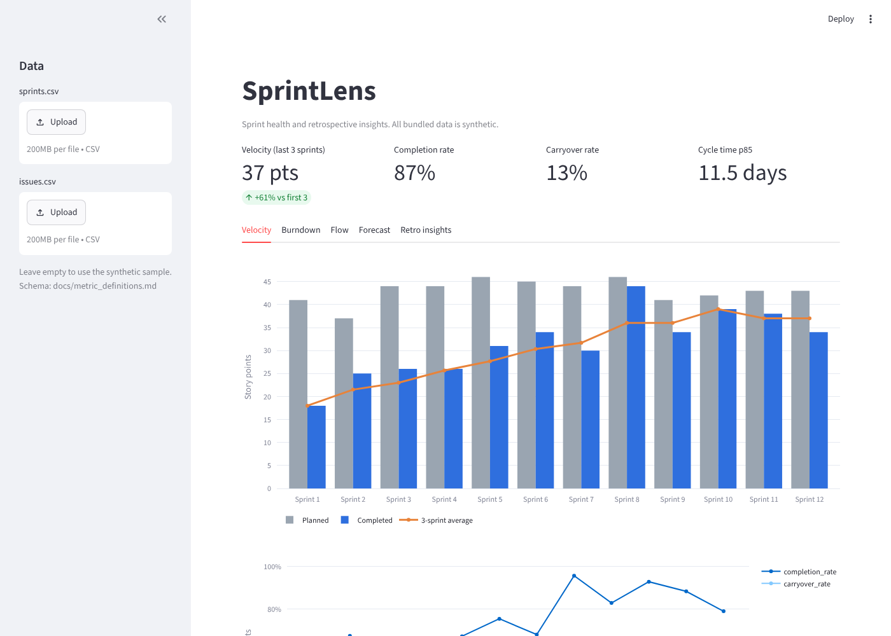
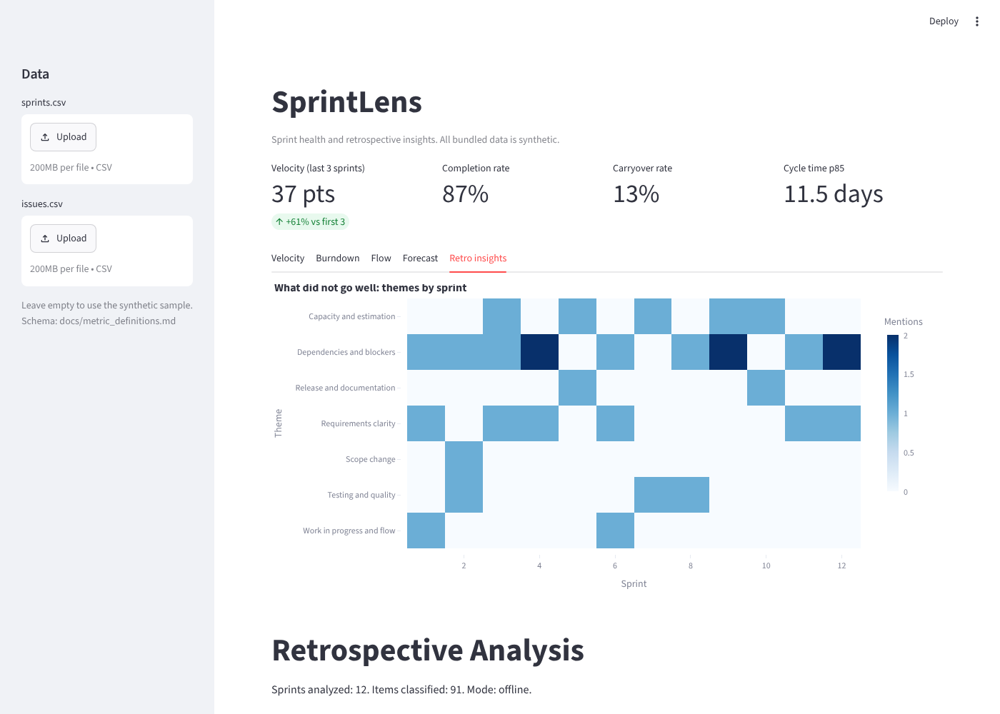

# SprintLens

**Live demo:** https://sprintlens.streamlit.app/

Sprint health metrics and AI-assisted retrospective analysis for Scrum teams.

SprintLens answers two questions a Scrum Master is asked every sprint:

1. **Is the team delivering predictably?** A dashboard turns a Jira-style export into velocity, completion, carryover, burndown, cycle time, work in progress, and a probabilistic forecast.
2. **What keeps coming up in our retrospectives?** An analyzer reads retrospective notes, groups them into themes, flags recurring and worsening problems, and drafts action items for the team to refine.



## The problem

Teams run retrospectives and then lose the pattern. The same issues resurface under different wording, and delivery metrics sit in a different tool from the conversation about why they moved. SprintLens puts both views side by side so a team can see whether an action item changed the numbers.

## Who it is for

| User | Need |
|---|---|
| Scrum Master | Evidence for retrospectives and stakeholder updates |
| Product Owner | Realistic forecasts instead of single-date promises |
| Team members | A shared, blame-free view of flow and recurring friction |

## Outcome shown in the sample data

The bundled dataset is **entirely synthetic**. It models a team that starts with unclear stories and high carryover, introduces a Definition of Ready at sprint 5, and improves. In the sample, average velocity over the last three sprints is about 61 percent higher than the first three (23 to 37 points), carryover falls from 43 to 13 percent, and median cycle time falls from 8.5 to 5.5 days. The retro analyzer flags "Dependencies and blockers" and "Requirements clarity" as recurring themes, which is the kind of pattern a team would then test with an action item.



## Quick start

```bash
pip install -r requirements.txt
make data      # regenerate synthetic data (optional, a copy is committed)
make retro     # write reports/retro_report.md
make app       # open the dashboard
make test      # run the tests
```

## Using your own data

Upload `sprints.csv` and `issues.csv` in the dashboard sidebar. Column definitions are in [docs/metric_definitions.md](docs/metric_definitions.md), including how to map a Jira export. Place retrospective notes in `data/retros/` as `sprint_NN.md` files using the format below.

```markdown
## What went well
- ...
## What did not go well
- ...
## Action items
- ...
```

## AI mode

By default the analyzer is deterministic and runs offline using keyword rules. To classify with a language model and add a short narrative summary:

```bash
export ANTHROPIC_API_KEY=...
python -m sprintlens.retro_analyzer --llm
```

Design choices:

- The model must pick from a fixed theme taxonomy, so results stay comparable across sprints.
- Invalid or missing answers fall back to the offline rules, so a bad response never breaks the report.
- The model name is configurable with `SPRINTLENS_MODEL`.
- In this mode retrospective text is sent to the API. Use only notes you are permitted to share.

## Repository layout

```
src/sprintlens/generate_data.py   synthetic sprints, issues, retro notes
src/sprintlens/metrics.py         velocity, burndown, cycle time, WIP, forecast
src/sprintlens/retro_analyzer.py  parser, classifier, report generator
app/streamlit_app.py              dashboard
docs/                             PRD, backlog, roadmap, metric definitions, team guide
tests/                            unit tests, including a stubbed LLM
```

## Documentation

- [Product requirements](docs/PRD.md)
- [Backlog](docs/backlog.md)
- [Roadmap](docs/roadmap.md)
- [Metric definitions](docs/metric_definitions.md)
- [How I would use this with a team](docs/team_usage.md)

## Data and privacy

All data in this repository is generated by `generate_data.py`. No employer, client, or real team data is included. `data/private/` is git-ignored for local experiments.

## Limitations

- Velocity and story points are team-specific. Do not compare teams or rank people with these metrics.
- Keyword classification is coarse. LLM mode is better at nuance but needs review.
- The forecast samples historical velocity and assumes the future resembles the past.

## License

MIT
